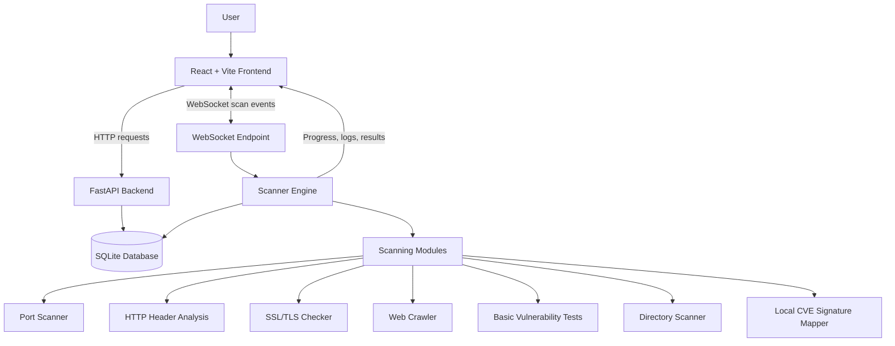

# ThreatLens

**Web Application Vulnerability Scanner & Security Assessment Platform**

ThreatLens is a web-based security assessment project built with **React, Vite, Python, and FastAPI**. It provides a dashboard for running authorized web application assessments, viewing scan progress in real time, reviewing findings, and exporting reports.

> **Project purpose:** Demonstrate practical full-stack development and foundational web security assessment techniques in a modular application.

## Table of contents

- [Overview](#overview)
- [Features](#features)
- [Technology stack](#technology-stack)
- [Architecture](#architecture)
- [Scanning modes](#scanning-modes)
- [Scanner modules](#scanner-modules)
- [Project structure](#project-structure)
- [Requirements](#requirements)
- [Installation and setup](#installation-and-setup)
- [Running the application](#running-the-application)
- [Using the scanner](#using-the-scanner)
- [API endpoints](#api-endpoints)
- [Reports and scan history](#reports-and-scan-history)
- [Current limitations](#current-limitations)
- [Security and responsible use](#security-and-responsible-use)
- [Future improvements](#future-improvements)

## Overview

ThreatLens separates the user interface from the scanning engine:

- The **React frontend** provides the dashboard, scan configuration, live logs, findings, history, and settings screens.
- The **FastAPI backend** exposes HTTP endpoints and a WebSocket endpoint, coordinates scan execution, and stores scan history.
- The **scanner engine** runs the modules appropriate to the selected scan mode.
- **SQLite with SQLAlchemy** stores scan history and assessment metadata.

The frontend communicates with the backend over HTTP for API operations and WebSockets for live scan updates.

## Features

- Dashboard with backend health and scan-history statistics.
- Target connectivity check.
- Quick, Full, and Advanced scan modes.
- Modular network and web assessment checks.
- Live scan logs and progress through WebSockets.
- Scan history with target, scan type, date, duration, risk score, and findings count.
- Finding details and remediation guidance in the scanner interface.
- PDF and JSON report export from the scan results interface.
- Dark/light theme support.

## Technology stack

| Area | Technologies |
|---|---|
| Frontend | React 18, JavaScript, HTML, CSS |
| Frontend tooling | Vite |
| Routing and UI | React Router, Lucide React |
| HTTP communication | Axios |
| Backend | Python 3.11, FastAPI, Uvicorn |
| Real-time communication | WebSockets |
| Database | SQLite, SQLAlchemy |
| Report generation | jsPDF, html2canvas |

## Architecture



### Request and scan lifecycle

1. The user enters a target and selects a scan mode in the React interface.
2. The frontend opens a WebSocket connection to the backend and sends the target and scan type.
3. FastAPI passes the request to the scanner engine.
4. The engine executes the modules associated with that mode.
5. Progress events, text logs, and the final result are sent to the frontend.
6. Scan metadata and history are persisted in SQLite.
7. The frontend renders the results and provides report export options.

## Scanning modes

| Mode | Intended checks |
|---|---|
| **Quick** | Common-port checks and HTTP security-header analysis |
| **Full** | Quick checks plus SSL/TLS checks, crawling, and basic form/injection testing |
| **Advanced** | Full checks plus predefined directory/path discovery |

The exact checks depend on the scanner implementation and target responses. A scan result is an assessment signal, not proof that a vulnerability is exploitable.

## Scanner modules

| Module | Role |
|---|---|
| Port scanner | Checks a configured set of common TCP ports. An open port alone is not a vulnerability. |
| Header analysis | Checks for selected HTTP security headers and reports missing configuration controls. |
| SSL/TLS checker | Inspects TLS certificate and connection validation information. |
| Web crawler | Discovers pages and links reachable from the starting target. |
| Vulnerability tester | Performs basic checks for selected web input issues; results require manual validation. |
| Directory scanner | Checks a small set of predefined paths in Advanced mode. |
| CVE mapper | Compares selected server-header signatures against a small local mapping dataset. |

**CVE coverage note:** The current mapper is a lightweight local signature map. It is not a live NVD feed, a comprehensive product-version matcher, or a guarantee that a listed CVE affects the target.

## Project structure

The main application folders are organized as follows (some supporting files may vary by project version):

```text
ThreatLens/
├── backend/
│   ├── main.py
│   ├── config.py
│   ├── database.py
│   └── scanner/
│       ├── engine.py
│       └── modules/
│           ├── port_scanner.py
│           ├── ssl_checker.py
│           ├── crawler.py
│           ├── vuln_tester.py
│           ├── directory_scanner.py
│           └── cve_mapper.py
│
├── frontend/
│   ├── src/
│   │   ├── components/
│   │   ├── context/
│   │   ├── pages/
│   │   ├── services/
│   │   ├── utils/
│   │   ├── App.jsx
│   │   └── index.css
│   ├── package.json
│   └── index.html
│
└── README.md
```

## Requirements

Install these tools before setting up the project:

- Python **3.11**
- Node.js (compatible with the Vite project)
- npm
- Git
- A modern web browser

Optional: Docker, for running the OWASP Juice Shop practice target described below.

## Installation and setup

The commands below use **Windows PowerShell** and assume the repository is cloned locally.

### 1. Clone the repository

```powershell
git clone https://github.com/vpradeep29/ThreatLens.git
cd ThreatLens
```

To use the current development branch:

```powershell
git checkout frontend/backend-aligned-upgrade
```

### 2. Set up the backend

From the repository root:

```powershell
py -3.11 -m venv backend/.venv
.ackend/.venv/Scripts/Activate.ps1
python -m pip install --upgrade pip
pip install -r backend/requirements.txt
```

If PowerShell blocks virtual-environment activation, you can run this for the current terminal session:

```powershell
Set-ExecutionPolicy -Scope Process -ExecutionPolicy Bypass
.ackend/.venv/Scripts/Activate.ps1
```

### 3. Configure the backend

Review `backend/config.py` and the project's settings before running it. If your local configuration requires environment variables, create a local `.env` file using the variable names expected by that settings module.

Do not commit real credentials, API keys, or private environment files.

### 4. Set up the frontend

Open a second PowerShell terminal at the repository root:

```powershell
cd frontend
npm ci
```

If there is no `package-lock.json` in your checkout, use `npm install` instead.

For a backend running at the default local address, the frontend uses:

```text
http://localhost:8000
```

If you need a different backend URL, create `frontend/.env` and set:

```env
VITE_API_BASE_URL=http://127.0.0.1:8000
```

Restart the Vite development server after changing environment variables. Do not put secrets in `VITE_*` variables because frontend values are exposed to the browser.

## Running the application

Run the backend and frontend in **two separate terminals**.

### Terminal 1 — Backend

From the repository root:

```powershell
.ackend/.venv/Scripts/Activate.ps1
cd backend
uvicorn main:app --reload --host 127.0.0.1 --port 8000
```

Backend URLs:

- API root: http://127.0.0.1:8000/
- Health check: http://127.0.0.1:8000/health
- Interactive API docs: http://127.0.0.1:8000/docs

### Terminal 2 — Frontend

From the repository root:

```powershell
cd frontend
npm run dev
```

Open the local URL printed by Vite, normally:

http://localhost:5173

### Production frontend build

From the `frontend` directory:

```powershell
npm run build
npm run preview
```

The production assets are generated in `frontend/dist`. The preview server is for local verification; it is not a production deployment configuration.

## Using the scanner

1. Start the backend and frontend.
2. Open the frontend in your browser.
3. Confirm the dashboard can reach the backend.
4. Open the Scanner page.
5. Enter a URL for a system you own or have explicit permission to test.
6. Select Quick, Full, or Advanced.
7. Start the scan and observe the live logs.
8. Review the returned findings, risk score, and remediation guidance.
9. Export the results as PDF or JSON if needed.
10. Open Scan History to review saved scan records.

### Safe local practice target: OWASP Juice Shop

You can run a deliberately vulnerable training application locally with Docker:

```powershell
docker run --rm -p 3000:3000 bkimminich/juice-shop
```

Use this target in ThreatLens:

```text
http://127.0.0.1:3000
```

Stop the container with `Ctrl+C` in the terminal where it is running.

## API endpoints

| Endpoint | Method | Purpose |
|---|---|---|
| `/` | GET | Backend service information |
| `/health` | GET | Health check |
| `/api/test-connection` | POST | Checks target connectivity |
| `/api/history` | GET | Retrieves scan history |
| `/ws/scan` | WebSocket | Starts a scan and streams messages/results |

The WebSocket client sends a JSON message containing `target` and `scan_type`. The backend can send both plain-text log messages and structured JSON events.

## Reports and scan history

The dashboard reads backend health and scan-history data. The history view displays stored scan records. The scanner results view supports:

- **PDF:** a formatted report for sharing or review.
- **JSON:** structured scan result data for further analysis.

The dashboard's aggregate risk value is calculated from recorded scan history; it should not be interpreted as a live security rating of the target or the user's environment.

## Current limitations

ThreatLens is an educational and portfolio-stage project. Current limitations include:

- No verified user authentication or role-based access control.
- Target authorization and strict scan-scope enforcement need to be implemented before broader use.
- Some network and web checks are heuristic and can produce false positives or false negatives.
- The directory scanner checks a limited predefined list of paths.
- The CVE mapper uses a small local signature database rather than comprehensive, version-aware vulnerability intelligence.
- Scan execution and concurrency controls need further hardening for multi-user or production deployments.
- PDF report rendering and all displayed scan data should be treated as untrusted input and hardened before production use.

## Security and responsible use

**Use ThreatLens only against systems you own or have explicit written authorization to assess.**

Do not use it to scan arbitrary public websites, third-party infrastructure, or networks without permission. Run practice targets locally in an isolated environment.

Before exposing this application to a network or deploying it publicly, implement and verify:

- Strict target allowlisting and scope validation.
- SSRF protections, including blocking loopback, private, link-local, and cloud metadata destinations where appropriate.
- Safe redirect handling and DNS/IP revalidation.
- TLS certificate verification by default.
- Authentication, authorization, rate limits, and audit logging.
- Resource limits, timeouts, and concurrency controls.
- Output encoding and safe report generation.

Do not treat this project as a production-grade security scanner without those changes and a security review.

## Future improvements

- Strict target-scope validation and authorization.
- Authentication and role-based access control.
- More reliable vulnerability verification and false-positive reduction.
- Version-aware CVE enrichment and updated vulnerability intelligence.
- Expanded API security assessment.
- Asset inventory and discovery workflows.
- OWASP Top 10 finding categorization.
- Scan scheduling, cancellation, and concurrency management.
- Automated backend and frontend tests.
- Improved report templates and deployment documentation.

## Author

**Pradeep Vadlamani**

- GitHub: [@vpradeep29](https://github.com/vpradeep29)
- Project: [ThreatLens](https://github.com/vpradeep29/ThreatLens)

---

If you find an issue or have a suggestion, please open a GitHub issue with steps to reproduce it.
